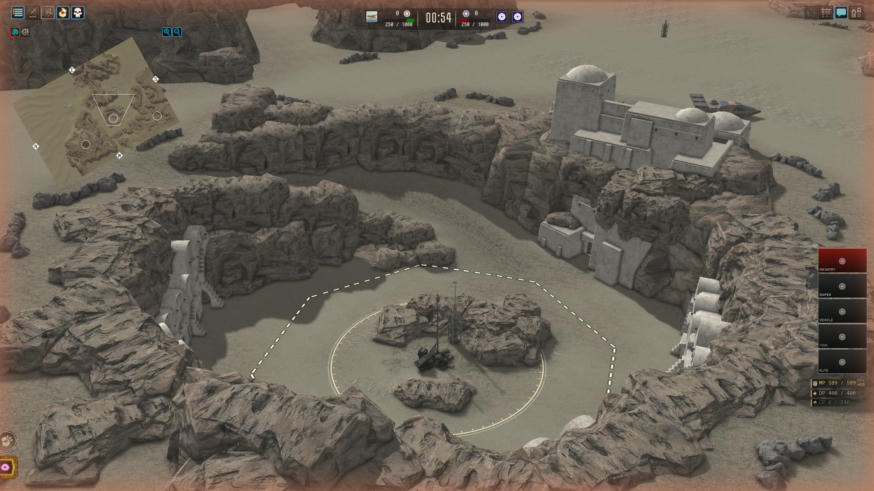
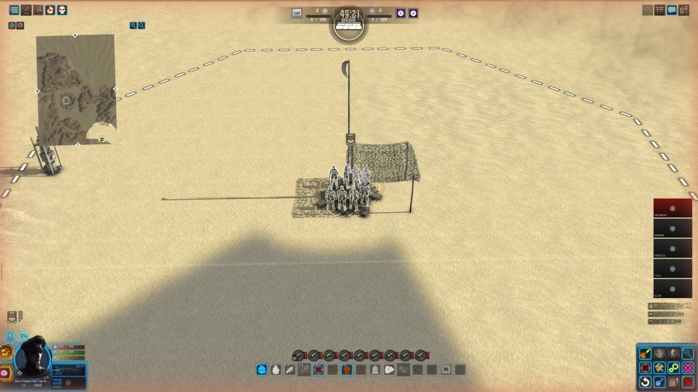
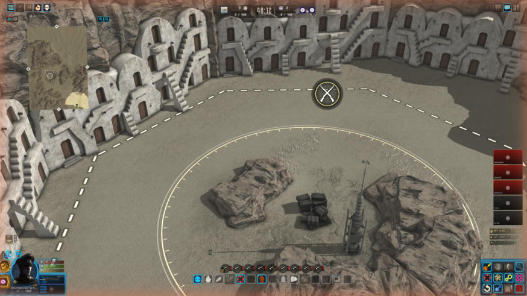

# GAW Skirmish: Light vs Dark

An unofficial add-on for **Star Wars: Galaxy At War**, a mod for *Call to Arms – Gates of Hell: Ostfront*. It makes the mod playable in **skirmish vs AI** and **multiplayer (PvP)**.

Built and tested on game version **1.069**.

## What you get

**Light Side**
- Infantry: clone troopers (standard, 21st Galactic Marines, 65th), clone engineers, Delta Squad, Wookiee warriors with Chewbacca and Tarfful, and Naboo guards.
- Vehicles: the Republic TX-130 family, TX-80, BARC speeder and infantry support platform, the Rebel T1/T2 and AAC hovertanks, the 520 battle platform, the V-19 and V-25 speeders, the Wookiee battle scythe, and LAAT gunships.

**Dark Side**
- Infantry: B1 droids (squads, AT, flamers, snipers, engineers), BX commandos, Imperial engineers, Geonosians, Killiks, Tusken Raiders, Czerka droids, and Black Krrsantan.
- Vehicles: the AAT (standard and flamer), AMT, AST, HAML and HAG-M artillery, the STAP, the Imperial AAT, TX-130s and ARV-7, the Canderous tank, the Starhawk, the Bantha-II skiff, the droid bomber, the Imperial LAAT and the Death Star turbolaser.

**Specialist tab (both sides)**, modelled on the vanilla single-unit tab:
- Light Side: Clone Trooper (rifle or carbine), Wookiee Heavy Gunners, Clone AT Troopers, Clone Engineers, AT and AP Mine Layers, Clone Medic, Clone Tank Crew, Clone Officer, Clone Sniper Team.
- Dark Side: B1 Battle Droid, B1 Heavy Blaster Team, Tusken Heavy Gunners, B1 Rocket Droids, B1 Flamer Droid, B1 Engineer Droids, AT and AP Mine Layer Droids, B1 Medic Droid, Droid Tank Crew, OOM Command Droid, B1 Sniper Droids.
- Kits match vanilla. Engineers get the full build menu (barricades, barbed wire, hedgehogs, foxholes, mortar pits, tank covers). Miners carry AT or AP mines. Medics carry 22 bandages and 2 medic tent kits.

**Also included**
- A main buy menu for each side, plus a doctrine panel with elite and hero units in tiers I–III.
- A working AI for both sides, which buys infantry, AT and tanks. In Domination it pushes objectives and the enemy HQ instead of idling at its own HQ.
- Engineers that build defenses and lay mines, like the base-game factions.
- Extra **Custom** game settings with much more CP and manpower: CP 300, 400 and 600, with up to 20,000 MP.
- Fixes for crashes in Galaxy at War on game 1.068 and later.

**Star Wars map**
- **(4) Tatooine Wastes**: a 2v2 desert map ported from the Galaxy at War expanded add-on for Men of War: Assault Squad 2. Tested in game in both **Battle Zones** and **Domination**: zones capture, scores count, and matches end in victory or defeat. In the lobby's map list it's near the bottom.
- Domination follows the vanilla rules: one objective is active at the start, another unlocks every 5 minutes, an objective takes 150 seconds to capture and an HQ takes 180.

## What's new in v1.4

- **Clone Heavy Gunners** with the Z-6 rotary blaster, in clone squads and as a specialist pair. The AI buys them too.
- **B1 heavy gunners** now carry the E-5M repeater (75-round belt, 550 rpm) instead of the 35-round E-5C.
- **Grenades:** squads carry vanilla-style smoke and AT grenades on the right members, on both sides. AP and AT detonators now show their explosion effects.
- **Elites:** 21st, 65th, Geonosian Elite and Czerka units get skill rank 3, tier-3 health and max veterancy. Delta Squad and BX commandos get max veterancy and bigger grenade kits.
- **Vehicles:** every secondary turret has a crew member and keeps firing while you aim the main gun (the T1-B (M) missile pod and T2-A machine gun never fired before). Vehicles spawn with one crewman per real seat, so 1-seaters no longer bring extra crew.
- **Speeders:** the Heavy STAP, Starhawk, 105-K lancer bike and the V-19/V-25 side guns can swivel ±45° to aim.
- Medics and AP mine layers on both sides. The elite auto turret was removed.

## Screenshots

Tatooine Wastes in Battle Zones:



Tatooine Wastes in Domination, showing the Light Side field HQ and the center objective:




## Install

You and everyone you play with need **the same two mods**:

1. **Galaxy At War** (base mod): subscribe on the Steam Workshop at
   <https://steamcommunity.com/sharedfiles/filedetails/?id=2846452104>
2. **This add-on**, either way (they are the same mod, file for file):
   - **Steam Workshop (easiest):** subscribe at <https://steamcommunity.com/sharedfiles/filedetails/?id=3841560743>
   - **Or GitHub:** download **`gaw_skirmish_light_vs_dark.zip`** from the [Releases](../../releases) page and extract it so the **`mod_3841560743`** folder ends up here:
     ```
     ...\steamapps\common\Call to Arms - Gates of Hell\mods\mod_3841560743\mod.info
     ```
     Keep the folder name `mod_3841560743` exactly. It's the name the Workshop copy loads under, so a GitHub player and a Workshop player see the same mod.

   Use only **one** copy. If you subscribed on the Workshop, don't also keep a GitHub copy, or an older `mods\gaw_fixes` folder, from v1.2 or earlier.

**Do not enable the "Galaxy At War – Conquest" add-on** with this. It replaces the base-game factions, and on 1.068 it crashes skirmish matches.

## Enable it

In the GoH Mod Manager, or the game's Extras → Workshop menu, enable the two mods **in this order**:
1. Galaxy_At_War
2. GAW Skirmish - Light vs Dark

Turn other mods off.

## Play

1. Go to **Multiplayer → Skirmish**, then either **Local Skirmish** to play the AI, or create an online game for PvP.
2. In the lobby, set **Army Selection Mode** to **Specific Nations**.
3. Set **A Team** to **Light Side** and **B Team** to **Dark Side**.
4. Optional: set **Game settings** to **Custom** for the high-CP / high-manpower presets.

## Known issues

- Aircraft (the LAAT gunships and droid bomber) are lightly tested. Game 1.068 removed the collision profile they use, so they may behave oddly.
- The lobby's doctrine preview window may be empty. The doctrine units themselves work in-game.
- Unit cards are simple faction-colored placeholders. Galaxy at War has no card art for most units.
- Galaxy at War has no medic models, so medics use the clone trooper and B1 droid models.
- Battle Zones and Domination have been played. Frontlines and Last Stand should work but are untested.
- On Tatooine Wastes, the parked vehicles and a few props from the original map were left out, because Gates of Hell can't load them.

## Updating

Workshop subscribers update automatically. GitHub users: delete your old `mods\mod_3841560743` folder, then extract the new zip in its place. Coming from v1.2 or earlier, also delete the old `mods\gaw_fixes` folder. Both players need the same version.

## Credits

All Star Wars models, skins, weapons and units belong to the **Star Wars: Galaxy At War** team. This add-on only reorganizes them into skirmish factions and fixes compatibility. Star Wars is a trademark of Lucasfilm/Disney. This is a non-commercial fan project.
